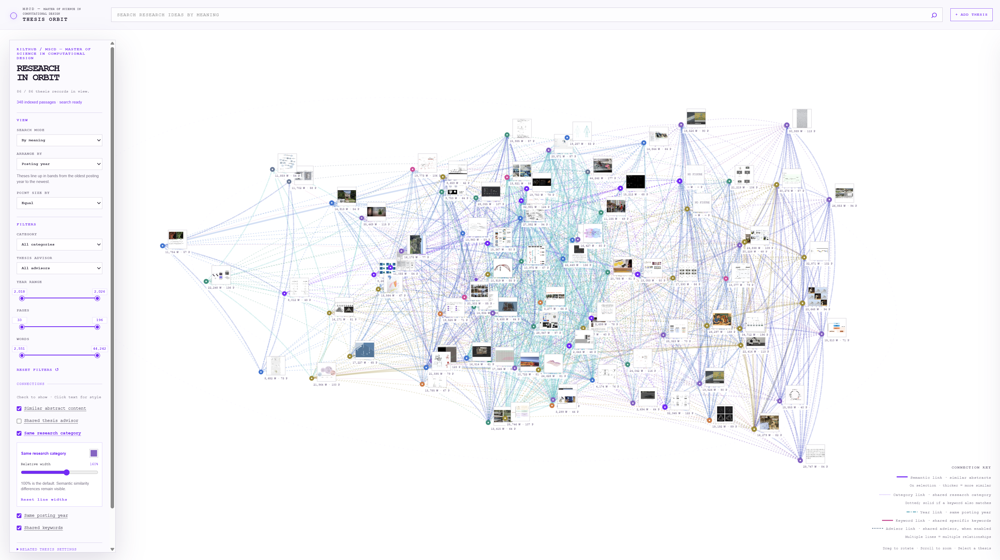

# MSCD — Master of Science in Computational Design Thesis Orbit



## 1. Purpose

This app shows the research landscape of MSCD — Master of Science in Computational Design theses as a 3D orbit. I chose this idea because I just started the master's program and have many questions about the thesis path: how long the documents are, what they study, and how much I may need to explain. I had already seen the online list of theses, so I collected its information into a visual tool.

## 2. Data

The data comes from the public [KiltHub MSCD collection](https://kilthub.cmu.edu/). One item is one thesis. The app currently has 86 theses. Each thesis has an abstract, title, author, year, advisors, category, keywords, page count, word count, image, and source link. For semantic search, the abstracts are split into 348 short passages of up to 70 words, with a small overlap between passages. The raw PDFs and model files are not committed; the scripts download the public records and create the local database again.

## 3. Adding and exploring

Use **+ ADD THESIS** to add a title and abstract or description; it becomes searchable immediately. Search by exact words or meaning, select a thesis to see semantic neighbors, or organize by topic, advisor, category, year, pages, or words. Filters help compare document scope and length.

## 4. Semantic examples

These queries use different words from the retrieved thesis titles, so keyword search could miss them:

| Query | Retrieved item | Why keyword search could miss it |
| --- | --- | --- |
| `an automated arm assembling timber` | *Responsive Robotic Assembly with Heterogeneous Raw Wood* | The query uses “arm,” “assembling,” and “timber,” while the title uses “robotic,” “assembly,” and “wood.” |
| `objects that bend and change their shape` | *Robotic Metamaterials: An Integrated Modular Approach for Users to Create Robotic Applications Hands-on* | The query describes changing objects, while the title uses “metamaterials” and “robotic applications.” |

The app uses the meaning of the text, not only exact words. These examples should also be shown in the project video.

## Interface notes

The 3D orbit can be organized by semantic topic, advisor, category, year, pages, or words. Selecting a thesis shows its semantic neighbors; line thickness represents similarity. The sidebar includes filters, range sliders, line controls, zoom, and reset buttons. A short [code guide](CODE_GUIDE.md) explains the modules and data flow.

### Setup

Python 3.11+ is recommended. Run from the project folder:

```powershell
python -m venv .venv
.\.venv\Scripts\Activate.ps1
python -m pip install -r requirements.txt
python scripts\import_collection.py --all
python scripts\enrich_documents.py
python scripts\enrich_advisors.py
python scripts\build_vectors.py
python app.py
```

Open **http://127.0.0.1:8000**. Enrichment fetches public PDF figures, metrics, and advisors and may take several minutes. Original figures belong to the thesis authors; source links and figure provenance appear in the app.

### Technology and limitations

ChromaDB 1.5.9 persists passage vectors and averaged thesis profiles in `data/chroma_store/`. FastEmbed 0.9.0 runs `sentence-transformers/paraphrase-multilingual-MiniLM-L12-v2` locally (384 dimensions). The first build downloads weights into `data/model-cache/`; no API key is required. SQLite stores editable metadata in `data/theses.db`. Adding, editing, and deleting records updates their vectors.

### Role of each language

- **Python** runs the local server, reads and updates the SQLite database, imports and enriches thesis records, generates embeddings, performs semantic retrieval, and exposes the API used by the interface.
- **JavaScript** runs in the browser and controls the interactive 3D orbit, canvas rendering, filters, search, layouts, semantic connections, sliders, zoom, and thesis selection. The project uses JavaScript, not Java.
- **CSS** defines the visual system: typography, spacing, responsive panels, controls, thumbnails, legends, line styles, and the white CAD-inspired interface.
- **HTML** provides the structure and accessible controls: the search field, sidebar, filters, connection settings, legend, detail panel, and canvas container that JavaScript renders into.

The map uses a 3D PCA projection preserving about 21% of variation in this build, so visual distance is approximate. Recommendations use original vectors. Abstract similarity does not fully describe research scope. Advisor grouping uses the first listed advisor; filtering includes co-advisors.

Do not commit PDFs, model caches, or generated databases. The commands above rebuild the collection from the public source; the importer implements the MSCD — Master of Science in Computational Design search filter.

### AI use and sources

AI helped me plan the data structure, write and debug code, create the embedding workflow, and improve the documentation. I checked the thesis information against the public source records. Important prompts and development notes are in [`prompt_log.md`](prompt_log.md).

Sources: [KiltHub](https://kilthub.cmu.edu/), [ChromaDB documentation](https://docs.trychroma.com/), and [FastEmbed documentation](https://qdrant.github.io/fastembed/).

### Verification

```powershell
python -m unittest discover -s tests -v
node --test tests/test_relations.mjs tests/test_orbit.mjs tests/test_constellations.mjs tests/test_line_widths.mjs tests/test_render_cache.mjs tests/test_zoom.mjs
```

Tests cover semantic retrieval, persistence, runtime additions, API operations, metadata relations, and stable framing. Original abstracts and metadata come from KiltHub. Important prompts and development notes are recorded separately in `prompt_log.md`.
